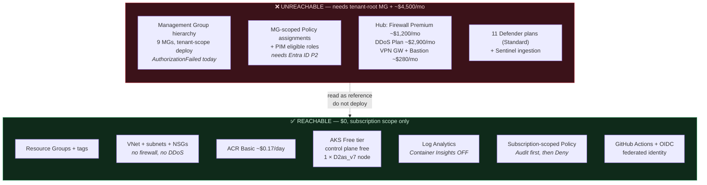
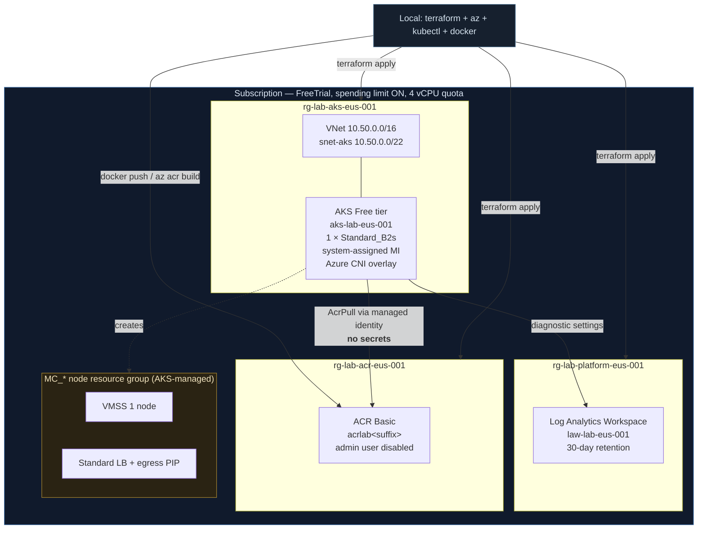
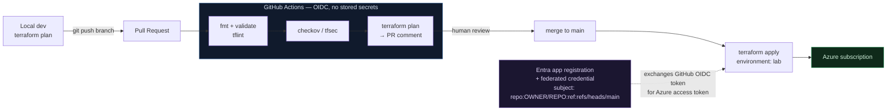
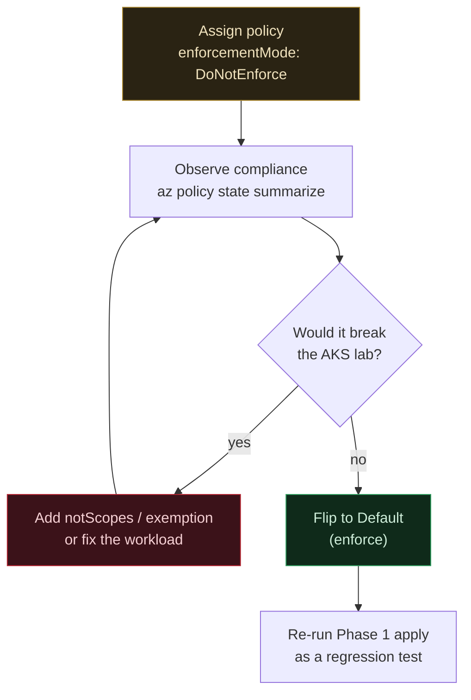

# Free-Tier Automation Lab — Design & Roadmap

> **Audience**: the repository owner, practising end-to-end Azure automation on a Free Trial
> subscription. **Status**: Phases 0–3 implemented and verified. Phase 1 — ACR + AKS deployed,
> image pulled via managed identity, `LoadBalancer` Service reachable. Phase 2 — GitHub OIDC with
> no stored secret, remote state with Entra data-plane auth, PR-gated plan/apply. Phase 3 —
> subscription-scoped policy baseline running audit-first. Phases 4–5 pending.
> **Companion doc**: [`landing-zone-design.md`](landing-zone-design.md) describes the *enterprise
> target*. This document describes what is actually reachable today and how to get there.

---

## 1. Context — why this document exists

The goal is to practise **automating** Azure (workloads, AKS, ACR, governance, observability) on a
newly created Free Trial subscription, using this repository as the reference architecture.

Two hard realities force a separate plan rather than "just deploy the repo":

1. **The repository is a reference design, not deployable code.** It was committed in a single
   initial commit and never successfully validated. Three of its 32 Bicep templates do not
   compile, its Terraform hub cannot apply, and its CI validation gate is structurally incapable
   of failing. Evidence in §2.
2. **The target subscription cannot host the design.** The design assumes a tenant-root
   management group hierarchy and roughly **$4,500/month** of fixed-price platform services
   (DDoS Protection Plan, Azure Firewall Premium, VPN Gateway, Bastion, 11 Defender plans). The
   subscription has a 4-vCPU quota, no management-group access, and a $200 / 30-day credit.

The response is **not** to degrade the enterprise design. It is to add a parallel, honest lab
layer that teaches the same automation muscles at ~$0, and to treat the enterprise tree as
read-only reference — plus a backlog of real defects worth fixing as practice.

### Decisions taken

| Decision | Choice | Why |
|---|---|---|
| Cost model | $0 out-of-pocket | Spending limit is **On**, so overrun disables the sub rather than billing it |
| Code location | New `lab/` tree | Enterprise tree stays coherent as reference; nothing inherited is broken |
| Primary IaC tool | **Terraform** | `terraform destroy` is the primary cost control; mature AKS support; most transferable |
| CI/CD timing | Phase 2, after local works | Debugging IaC and debugging CI simultaneously is where people quit |

---

## 2. Evidence — the repository's actual state

Everything below was reproduced locally, not inferred.

### 2.1 Three templates do not compile

```
$ az bicep build --file <each>.bicep --stdout      # 29 passed, 3 failed
landing-zones/sandbox/main.bicep(32,29)      BCP065  utcNow() is only valid as a parameter default
monitoring/log-analytics/main.bicep(94,10)   BCP139  resource scope must match file scope
governance/policies/assignments/main.bicep(104,21) BCP020/BCP236/BCP022/BCP055  malformed expression
```

`monitoring/log-analytics/main.bicep` is the **first deployment step of workflows 05, 06 and 07**,
so every deploy pipeline in the repo fails at its first action.

### 2.2 The CI gate cannot fail — root cause

`.github/workflows/02-bicep-validate.yml` pipes `find` into `while`, so the loop body runs in a
**subshell** and its `FAILED=1` is discarded:

```bash
FAILED=0
find . -name "*.bicep" | while read -r file; do ... FAILED=1; done   # subshell
if [ $FAILED -ne 0 ]; then exit 1; fi                                # always 0 in bash
```

Verified: `bash` → `FAILED=0`; `zsh` → `FAILED=1` (zsh doesn't subshell the last pipeline stage,
which is why this is easy to miss when testing locally on macOS).

`scripts/bash/validate-bicep.sh` uses `< <(find …)` process substitution and is **correct** — the
local script catches what CI cannot. That asymmetry is how three broken templates were committed.

### 2.3 The Terraform hub cannot apply

`terraform/modules/networking/main.tf` derives subnets with mismatched `cidrsubnet` newbits:

```
AzureFirewallSubnet   cidrsubnet(prefix,10,0) -> 10.0.0.0/26
GatewaySubnet         cidrsubnet(prefix,11,1) -> 10.0.0.32/27   <-- inside 10.0.0.0/26
```

`10.0.0.32/27` sits inside `10.0.0.0/26` → subnet-overlap error on apply.

### 2.4 Other confirmed defects (backlog, not blockers for the lab)

| Defect | Location | Effect |
|---|---|---|
| Policy assignments request `SystemAssigned` identity, **zero** `roleAssignments` created | `governance/policies/assignments/main.bicep` (0 matches for `roleAssignments`) | `Modify` / `DeployIfNotExists` remediation can never work |
| `audit-encryption.json` `then` block has `effect` but no `details` | `governance/policies/custom/audit-encryption.json` | `AuditIfNotExists` is malformed; likely rejected at creation, and it's bundled into the security initiative |
| Initiatives hardcode `/managementGroups/Contoso/…` definition IDs | `initiatives/*.json:30,37,31,38` | Unresolvable in any tenant not literally named `Contoso` |
| Runbook content URI points at a non-existent GitHub repo | `landing-zones/sandbox/modules/auto-shutdown.bicep:30` | Runbook creation fails fetching content |
| Budget `startDate: '2024-01-01'` hardcoded in the past | `finops/budgets/main.bicep:34`, `sandbox-budget.bicep:14` | Consumption API rejects past start dates |
| Key Vault created with public access off, network ACL deny, RBAC on, and **no admin principals** | `terraform/modules/security/main.tf:17-25` | Vault is created and immediately unusable by anyone |
| `rg-platform-security-*` referenced but created nowhere | `terraform/modules/security` | `ResourceGroupNotFound` on apply |
| LAW sets `publicNetworkAccessForIngestion: 'Disabled'` with no Private Link Scope | `monitoring/log-analytics/main.bicep:36` | Workspace silently accepts zero ingestion |
| `enforce-tls` uses `notEquals "TLS1_2"` instead of a floor | `governance/policies/custom/enforce-tls.json` | Denies TLS 1.3, and denies resources that merely *omit* the property |
| Placeholder GUIDs as role IDs | `rbac/assignments/main.bicep:16-18` | `RoleDefinitionDoesNotExist` |
| Placeholder subscription IDs / `<...>` tokens | all `terraform/environments/*/backend.tf`, `*.tfvars`, `management-groups/parameters/*.json` | `terraform init` and deployments fail |

---

## 3. The gap: enterprise target vs. what is reachable



**Why the governance layer is unreachable, precisely:** you are Owner on the *subscription*, but
`Microsoft.Management/managementGroups/read` fails at `/providers/Microsoft.Management`. Tenant- and
MG-scoped deployments need a role assignment at the **root management group**, which does not exist
until a Global Admin performs *Elevate access* in Entra ID properties. That is a tenant-level
identity action, not something IaC can bootstrap. **This repo has no subscription-scoped policy
assignment template at all** — writing one is Phase 3, and it is genuinely the most valuable thing
you can build here.

---

## 4. Lab architecture

Deliberately boring. Every element exists because it teaches something, and nothing exists because
"real platforms have one".



### Design decisions and their reasons

| Decision | Why | What it costs you |
|---|---|---|
| **1 × `Standard_D2as_v7`** (2 vCPU, 8 GiB) | Regional quota is **4 vCPU total**. AKS's default 3 × `DS2_v2` = 6 vCPU fails outright. B-series was the plan but **is not offered to this subscription** — quota ≠ availability | ~$0.09/hr. No HA — accepted for a lab |
| **AKS Free tier** (`--tier free`) | Control plane is genuinely free; Standard tier adds ~$0.10/hr for an SLA you don't need | No uptime SLA |
| **Container Insights OFF initially** | This is *the* hidden cost driver in AKS labs — per-GB ingestion of every container's stdout. Turn it on deliberately in Phase 4 and watch the bill move | No container-level metrics until Phase 4 |
| **ACR Basic, admin user disabled** | Forces you to learn the correct auth path (managed identity + `AcrPull`) instead of the shortcut that every tutorial teaches and every real platform bans | ~$0.17/day |
| **Separate RGs per concern** | Teaches blast-radius thinking and makes `az group delete` a precise teardown tool | Slightly more Terraform wiring |
| **Local state in Phase 1, remote in Phase 2** | Remote state is a chicken-and-egg bootstrap (storage account must exist before `init`). Deferring it removes one failure mode while you're still learning HCL | Must run `terraform init -migrate-state` once |
| **`10.50.0.0/16`** | Deliberately *outside* the enterprise ranges (`10.0/10.10/10.20`) so lab and reference designs can never be confused | None |
| **Azure CNI overlay** | Pod IPs come from a private overlay, not the subnet — so a /22 supports far more pods, and it's the current Microsoft default recommendation | Slightly different from the kubenet you'll see in older tutorials |

### The cost arithmetic

| Item | Rate | 3-hour session |
|---|---|---|
| AKS control plane (Free tier) | $0 | **$0.00** |
| 1 × `Standard_D2as_v7` node (2 vCPU, 8 GiB) | ~$0.09/hr | ~$0.27 |
| Standard PIP (AKS egress) | ~$0.005/hr | ~$0.02 |
| ACR Basic | ~$0.167/day | ~$0.02 (prorated) |
| Managed disk 32 GiB | ~$0.002/hr | ~$0.01 |
| **Total per session** | | **≈ $0.34** |

A $200 credit funds roughly **500 practice sessions**. The credit is not the constraint —
**forgetting to destroy is**. A cluster left running for the full 30 days costs ~$75; the same
cluster with Container Insights on and chatty pods can cost several times that.

**Note:** `Microsoft.Consumption/budgets` — what `finops/budgets/` and `sandbox-budget.bicep`
deploy — is **not supported on Free Trial offers**. Those templates will fail with a billing-scope
error. Cost control here is therefore: spending limit (already On) + a teardown script + a manual
`az consumption usage list` habit. This is a genuine limitation, not something to engineer around.

---

## 5. Automation pipeline (Phase 2 onward)



**Why OIDC and not a client secret:** a federated credential means no long-lived secret exists to
leak or rotate. GitHub presents a short-lived OIDC token whose `subject` claim is bound to a
specific repo *and* ref; Entra exchanges it for an Azure token. This is the one pattern the
enterprise repo gets unambiguously right (`ARM_USE_OIDC`, `azure/login@v2` with `id-token: write`)
and is worth copying verbatim.

**Fix on the way in:** whichever validation loop you copy, use `< <(find …)` not `find … | while`,
or the gate silently passes (§2.2).

---

## 6. Phased roadmap

Each phase ends in something demonstrable and destroyable.

### Phase 0 — Bootstrap and guard-rails

- Register the six unregistered providers: `ContainerRegistry`, `OperationalInsights`, `Insights`,
  `Storage`, `KeyVault`, `Automation`.
- Standardise on **`eastus`** — it has the 4-vCPU quota, is in the repo's `allowedLocations`, and is
  the cheapest tier. (Your existing `myresourcegroup28761` is in `swedencentral`, which the repo's
  `allowed-locations` policy would *deny*. Worth knowing before Phase 3.)
- Write `lab/scripts/preflight.sh` — asserts subscription id, region quota, provider states, and
  tool versions, and refuses to proceed on mismatch.
- Write `lab/scripts/teardown.sh` — deletes every `rg-lab-*` group, `--no-wait`. This is the single
  most important script in the lab.

**Question to answer:** do you want the lab in *this* repo under `lab/`, or in its own repo? This
repo's `.github/workflows/` path filters and `CODEOWNERS` (`@contoso/*` teams that don't exist)
will interact with lab PRs. Recommendation: `lab/` in this repo, with lab workflows filtered to
`lab/**` and a `CODEOWNERS` entry pointing at you.

### Phase 1 — Terraform: ACR + AKS, local state, local apply

Module layout, mirroring the existing `terraform/modules/*` convention so the patterns transfer:

```
lab/terraform/
├── modules/
│   ├── platform/        # RG + Log Analytics workspace
│   ├── registry/        # ACR Basic, admin disabled
│   └── cluster/         # VNet + subnet + AKS + AcrPull role assignment
└── environments/lab/    # root module, local backend initially
```

Milestones:
1. `terraform apply` → ACR exists. Push an image with `az acr build` (no local Docker needed).
2. `terraform apply` → AKS exists, 1 node `Ready`.
3. `kubectl apply` a Deployment pulling from ACR — **succeeding via managed identity**, proving the
   `AcrPull` assignment works with no `imagePullSecret`.
4. Expose it with `Service type=LoadBalancer`, reach it over the internet.
5. `terraform destroy`, confirm `az group list` is clean.

**Why `az acr build` before `docker push`:** it builds server-side in ACR, so you learn the registry
and its auth model without conflating them with local Docker daemon problems. Do the `docker push`
variant afterwards, deliberately, to feel the difference.

**Expected friction (each is a lesson, not a bug):**
- AKS default node count 3 → quota error. You will fix it by *reading a quota error properly*.
- `Service type=LoadBalancer` sits at `<pending>` if anything blocks public IP creation.
- `AcrPull` role assignment takes up to a few minutes to propagate; the first pull may fail.

### Phase 2 — CI/CD with OIDC

1. Create the Entra app registration + service principal; grant it Contributor on the subscription.
2. Add a federated credential with subject `repo:<owner>/<repo>:ref:refs/heads/main`, and a second
   for `pull_request` so plans work on PRs.
3. Bootstrap remote state: RG + storage account (name must be globally unique — use a random
   suffix, never a hardcoded `stterraformstatedev001`) + `tfstate` container, then
   `terraform init -migrate-state`.
4. Grant the OIDC principal **Storage Blob Data Contributor** on the state container — RBAC on the
   data plane, which is the step everyone forgets.
5. Two workflows: `lab-plan.yml` (PR → fmt, validate, checkov, plan-as-comment) and
   `lab-apply.yml` (push to `main` → apply, GitHub Environment `lab`).

**Question to answer:** should `lab-apply.yml` require manual approval via a GitHub Environment
protection rule? Recommendation **yes** — it costs one click and builds the habit that applies are
gated. It also means a runaway `for_each` can't quietly create 50 nodes.

### Phase 3 — Governance, subscription-scoped (the highest-value phase)

The repo has **no** subscription-scoped policy assignment template. Build one, and learn the trap
that would otherwise waste a day:



**The trap, concretely.** Two of this repo's policies are `Deny` with `enforcementMode: 'Default'`
and no `notScopes`, and both break AKS in ways whose error messages do not mention policy:

- **`deny-public-ip`** matches *all* `Microsoft.Network/publicIPAddresses` unconditionally. AKS with
  the default `outboundType: loadBalancer` creates an egress PIP in its `MC_*` node resource group →
  **cluster creation fails** with an opaque reconcile error. Every `Service type=LoadBalancer` also
  hangs at `<pending>`, with the deny visible only in `cloud-controller-manager` logs. (The API
  server is *not* affected — that PIP lives in Microsoft's subscription, not yours.)
- **`require-tags`** demands five tags on every indexed resource. AKS does not propagate tags to all
  `MC_*` children (NSGs, route tables, load balancers), and CSI-provisioned PVC disks are created
  untagged → **cluster creation and every PVC fail**. The repo's tag-inheritance `Modify` policies
  cover only 2 of the 5 tags, and their assignment identities have no role assignment, so they
  cannot remediate anyway.

Sequence: assign as `DoNotEnforce` → observe → exempt or fix → then enforce. This is exactly how you
would roll out policy to a real tenant, so the lab teaches the real discipline.

### Phase 4 — Observability, then cost

- Diagnostic settings from AKS + ACR → Log Analytics, via Terraform.
- Turn Container Insights **on**, run a chatty workload, then look at ingestion GB and the cost.
  Turn it back off. The point is calibration.
- One metric alert + action group to your real email.
- KQL practice against `AzureDiagnostics` / `ContainerLog`.

### Phase 5 — Fix the enterprise repo (optional, high-value practice)

Ordered by value-to-effort, each a small PR with a real diff:

1. `02-bicep-validate.yml` subshell bug — the fix that makes every later fix visible. **Do first.**
2. The three compile errors (§2.1).
3. Terraform hub subnet overlap (§2.3).
4. Missing `roleAssignments` for policy-assignment identities.
5. `enforce-tls` floor-vs-equality bug.
6. Replace hardcoded globally-unique names with `uniqueString()` / `random_string`.

---

## 7. Open questions

| # | Question | Recommendation |
|---|---|---|
| 1 | Lab in `lab/` here, or separate repo? | `lab/` here, workflows path-filtered to `lab/**` |
| 2 | ~~Do you hold Global Admin on the tenant?~~ **Resolved: yes.** | Phase 3 may optionally include *Elevate access* at the root MG + a minimal MG hierarchy, unlocking the real MG-scoped governance layer instead of subscription-scope only |
| 3 | Manual approval gate on `lab-apply.yml`? | Yes |
| 4 | Do you intend to upgrade to Pay-As-You-Go at day 30? | Decide before day 25 — a Free Trial that lapses **disables** the subscription and its resources |
| 5 | Windows node pools / multiple node pools? | Not possible: 4 vCPU quota. Would need a quota increase request |
| 6 | Pin `azurerm` 4.x for the lab? | Yes — the enterprise tree pins `~> 3.90`, which is superseded; do not inherit it |

---

## 8. What this lab deliberately does **not** teach

Being explicit, so the gaps are known rather than assumed:

- **Hub-spoke, Firewall, forced tunnelling, private endpoints** — unaffordable. Read
  `networking/hub/` as reference; understand it without deploying it.
- **Management groups, MG-scoped policy, PIM, Conditional Access** — need root-MG elevation and
  Entra ID P1/P2.
- **Multi-environment promotion (dev→staging→prod)** — one subscription. The *mechanics* are
  learnable via Terraform workspaces or a second root module, but not the isolation.
- **HA, zone redundancy, disaster recovery** — single node, single zone, no SLA.
- **Defender for Cloud / Sentinel** — billable per resource and per GB.

Everything in that list is present in the enterprise tree as a worked example. The lab teaches the
*automation*; the enterprise tree documents the *architecture*. Keeping those separate is the whole
point of this plan.
